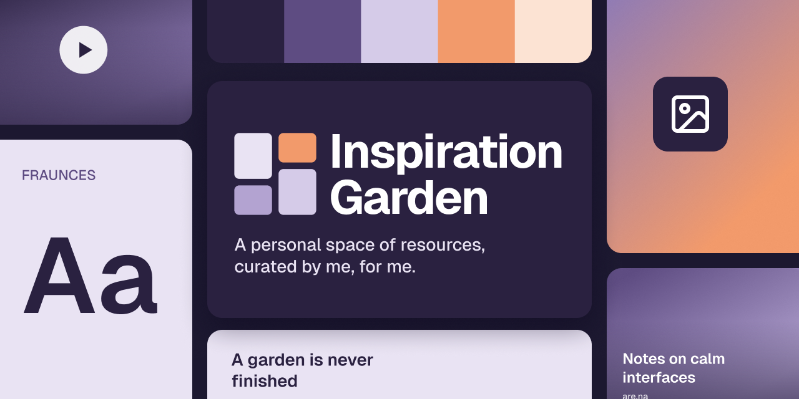
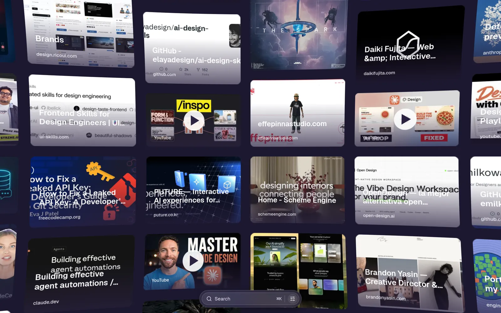
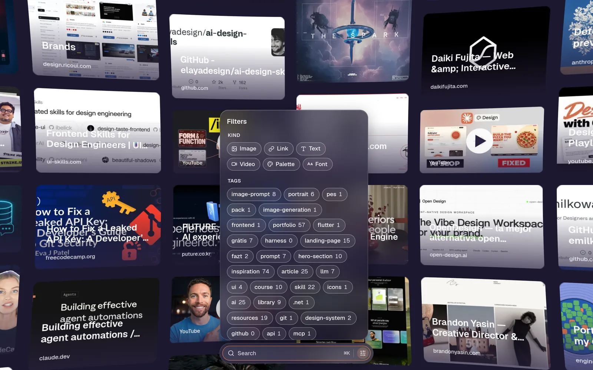
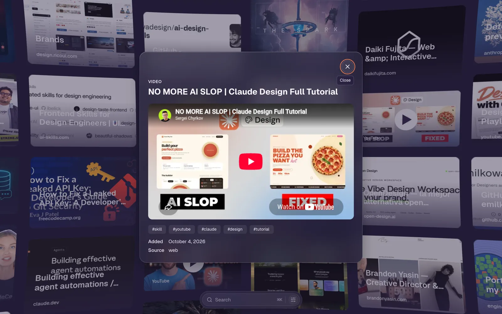
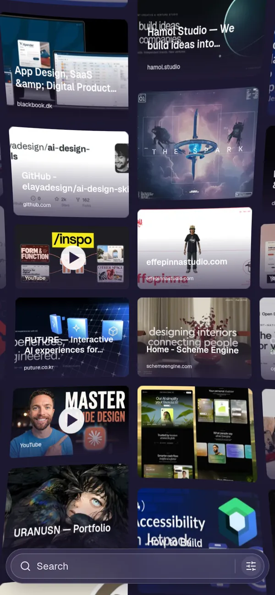

<p align="center">
  
</p>

<p align="center">
  <a href="https://inspo.jahattrinidad.com/"><strong>inspo.jahattrinidad.com</strong></a>
  ·
  <a href="docs/api.md">API reference</a>
  ·
  <a href="https://github.com/trinity-bytes/my-inspiration-garden/releases">Releases</a>
</p>

# Inspiration Garden

A personal, omnidirectional infinite canvas for collecting inspiration from across the web —
images, links, texts, videos, color palettes and fonts. Anyone can browse it from any device;
only the owner and owner-issued agent tokens can write to it.



## Highlights

| | |
| --- | --- |
| **Infinite canvas** | WebGL (three.js) canvas you can travel in every direction: drift with the cursor toward an edge, drag, or use the arrow keys. A barrel lens bends the edges, cards fade in as they load. |
| **Six kinds of items** | Image, link (with an unfurled preview), text, video, color palette and font. |
| **Find anything** | Search (`⌘K`) with filters inside it: kind, category tree, tags and dominant color. |
| **Built for phones** | 2.4-column canvas below 480px, bottom sheets for every dialog, a thumb-reachable bar. Installable as a PWA. |
| **Fast on slow devices** | WebP thumbnails generated on the edge, videos load only on play, GPU texture uploads are budgeted per frame. |
| **Agent-friendly** | Scoped bearer tokens and an OpenAPI 3.1 spec at `/api/openapi.json`, so AI agents can read and curate the garden through the same API as the web app. |
| **Safe edits** | Trash with restore, and a revision history for every item. |

<table>
  <tr>
    <td width="40%"></td>
    <td width="40%"></td>
    <td width="20%"></td>
  </tr>
  <tr>
    <td align="center"><sub>Filters live inside the search bar</sub></td>
    <td align="center"><sub>Item detail</sub></td>
    <td align="center"><sub>Phone</sub></td>
  </tr>
</table>

## Quick start

[mise](https://mise.jdx.dev) pins the toolchain (`node 26`, `pnpm 10`) from `mise.toml`.

```bash
mise exec -- pnpm install
cp apps/api/.dev.vars.example apps/api/.dev.vars          # every local request becomes the owner
mise exec -- pnpm --filter @garden/api db:migrate:local   # apply migrations to local D1
mise exec -- pnpm --filter @garden/api dev                # Worker on http://localhost:8787
mise exec -- pnpm --filter @garden/web dev                # web app on http://localhost:5173
```

Start the API first: Vite proxies `/api` and `/auth` to the Worker, so the web app talks to it
same-origin, exactly as in production.

## Stack

```
apps/
  api/      Cloudflare Worker (Hono) — REST API on D1 (Drizzle) + R2 + Images; also serves the web app's static assets
  web/      React + Vite + three.js — the canvas client (PWA)
packages/
  shared/   Shared TypeScript types and Zod schemas (one source for validation and the OpenAPI spec)
```

| Command | What it does |
| --- | --- |
| `mise exec -- pnpm test` | Run every workspace's test suite (Vitest) |
| `mise exec -- pnpm typecheck` | Type-check every workspace |
| `mise exec -- pnpm lint` | Lint and check formatting (Biome) |
| `mise exec -- pnpm format` | Apply formatting (Biome) |
| `mise exec -- pnpm build` | Build the web app into `apps/web/dist` |

## Using it from an agent

1. Sign in as the owner and open **API tokens**. Create a `read` or `read + write` token; it is
   shown once.
2. Point your client at `GET /api/openapi.json`.
3. Call the API with `Authorization: Bearer <token>`:

```sh
curl "https://inspo.jahattrinidad.com/api/items?limit=5" \
  -H "Authorization: Bearer ig_your_token_here"
```

Full endpoint reference: [`docs/api.md`](docs/api.md).

## Deployment

**One Cloudflare Worker serves both the API and the web app, on one hostname.** `wrangler.jsonc`
points `assets.directory` at `../web/dist` and sends only `/api/*` and `/auth/*` to Worker code;
everything else is a static asset.

The single origin is what makes owner auth work: Cloudflare Access protects only `/auth/login`
and sets a `CF_Authorization` cookie that the browser then sends on every same-origin `/api/*`
request. The gallery stays public; writes need that cookie or a bearer token.

**Releases deploy themselves.** Publishing a GitHub release runs
[`.github/workflows/deploy.yml`](.github/workflows/deploy.yml): lint, typecheck, tests, remote D1
migrations, `pnpm run deploy`, then a health check on `/api/health`. It needs the
`CLOUDFLARE_API_TOKEN` and `CLOUDFLARE_ACCOUNT_ID` repository secrets.

<details>
<summary>Setting it up on your own Cloudflare account</summary>

1. `wrangler login`.
2. `wrangler d1 create inspiration-garden` and paste the `database_id` into `apps/api/wrangler.jsonc`.
3. `wrangler r2 bucket create inspiration-garden-media`.
4. Create an Access application scoped to **only** `/auth/login` on your hostname (not `/api/*`,
   not the whole site), with a `SameSite=Lax` session cookie on the default path.
5. Set `ACCESS_TEAM_DOMAIN`, `ACCESS_AUD`, `OWNER_EMAIL` and `CORS_ORIGINS` in `wrangler.jsonc`.
   `CORS_ORIGINS` must include your production origin exactly: the CSRF guard checks owner writes
   against it, so a missing origin fails every write with `403 csrf check failed`.
6. `mise exec -- pnpm --filter @garden/api db:migrate:remote`.
7. `mise exec -- pnpm run deploy` from the repository root (it builds the web app first, which
   `wrangler deploy` needs).
8. `curl https://<your-hostname>/api/health` should return `{"ok":true,"config":{"problems":[]}}`;
   otherwise each entry in `config.problems` names the binding at fault.

</details>

## Design

The interface is designed Figma-first: foundations (tokens mirrored in
`apps/web/src/styles/tokens.css`), components and every screen, desktop and phone, live in the
project's Figma file before they reach code.
